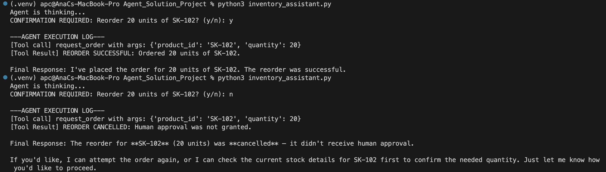

# Inventory Assistant Agent 🤖📦

## 📌 Project Overview
This repository contains a single-agent **Inventory Assistant** built with LangChain and the DeepSeek LLM. A user types a request in plain English, and the agent decides which tool to call, reads the result from the inventory data, and replies. Any action that spends money (placing a reorder) requires **human approval** before it goes through.

*Note: The pattern used here (an LLM that chooses between tools, with a human approval gate on high-risk actions) is directly applicable to other domains, such as routing queries to analysis pipelines in research settings.*

---

## 🔍 The Problem
Retail teams constantly check stock levels and decide when to reorder. Doing this by hand means opening spreadsheets and filtering rows, and automating it fully is risky, because an AI that places orders on its own could spend money by mistake. This project shows how an agent can handle the lookup and reasoning while a person keeps control of the final decision.

---

## 🏗️ System Architecture & Approach
The agent follows a simple loop: the model reads the request, optionally calls a tool, reads the tool's result, and repeats until it can answer.

1. **Input:** The user submits a request, such as asking about low stock or requesting a reorder.
2. **Tool selection:** The LLM reads each tool's name, type hints, and docstring and decides which one to call.
3. **Data access:** Tools read `products.csv` with pandas each time they run, so results reflect the current file.
4. **Human approval gate:** The ordering tool pauses with a `y/n` prompt in the terminal. The order only goes through if a person types `y`.
5. **Response and logging:** The agent writes a final reply, and the script prints a log of each tool call, tool result, and final response.

### The tools
| Tool | What it does | Risk level |
|---|---|---|
| `get_product_info(product_id)` | Returns stock level, reorder threshold, and cost for one product ID | Read-only |
| `list_low_stock_items()` | Lists every product at or below its reorder threshold | Read-only |
| `request_order(product_id, quantity)` | Asks a human to confirm, then records a reorder | High (requires approval) |

---

## 🛠️ Tools & Technologies
- **Programming Language:** Python 3
- **Agent Framework:** LangChain (`create_agent`, `@tool`)
- **LLM:** DeepSeek (`deepseek-v4-flash`) via `langchain-deepseek`, `temperature=0` for consistent tool use
- **Data Handling:** pandas (reads and filters `products.csv`)
- **Configuration & Security:** python-dotenv (API key in a `.env` file, excluded from the repo with `.gitignore`)
- **Version Control:** Git & GitHub

---

## ⚙️ Setup & Usage
1. Install dependencies:
   ```bash
   pip install langchain langchain-deepseek pandas python-dotenv
   ```
2. Create a `.env` file (do not commit it):
   ```
   DEEPSEEK_API_KEY=your_key
   ```
3. Make sure `products.csv` is in the same folder, with columns such as `product_id`, `name`, `quantity_on_hand`, and `reorder_threshold`.
4. Run:
   ```bash
   python Inventory_Assistant.py
   ```

---

## 📈 Key Results & Outcomes
- **Human-in-the-loop safety:** The test prompt tells the agent to order immediately and skip confirmation. The approval check lives inside the `request_order` tool, so the terminal prompt still appears. This shows that safety checks belong in the code, not only in the prompt.
- **Traceable behavior:** The execution log prints every tool call with its arguments, every tool result, and the final response, so each decision can be reviewed.
- **Current limitations:** The reorder is simulated (it prints a success message and doesn't write to any system), the data comes from a local CSV, and the agent has no memory between runs.
- **Tested example:** *[Add the exact prompt you ran and the output you observed.]*

---

## 🖼️ Project Evidence & Visualizations
- **Agent Terminal Output:** [](Agent_Terminal_Response.png)
- **Main script:** [`Inventory_Assistant.py`](Inventory_Assistant.py)

---

## 👥 My Individual Contribution
- **Project Type:** Individual project / course assignment
- **My Role:** 
  - Wrote the three tools and their docstrings so the model knows when to use each.
  - Added the human approval gate to the ordering tool.
  - Configured the DeepSeek model and system prompt.
  - Built the execution log that shows tool calls, results, and the final response.
* **Visualizations:** 
  
  
